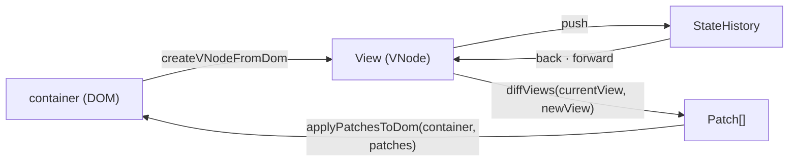

<!-- readme: archetype=team -->
# mini-react

Virtual DOM, Diff, Patch, Hooks를 바닐라 TypeScript로 직접 구현하면서 React가 이 기능들을 갖춘 이유를 이해하는 크래프톤 정글 팀 프로젝트입니다.

[](https://github.com/benjohnbill/mini-react/actions/workflows/ci.yml)

Status: active

## 실행

```bash
npm ci             # 도구 설치 (Node 버전: .nvmrc)
npm run dev        # 개발 서버에서 index.html 실행
npm run typecheck  # 타입 검사
npm run check      # 포맷, 린트, ADR이 인용한 테스트 ID 검사 (자동 수정: npm run format)
npm test           # 단위 테스트
npm run build      # 빌드
```

## Map (파일 지도)

```text
mini-react/
├── src/
│   ├── main.ts (entry)    페이지 시작 코드. index.html이 불러옴
│   ├── vnode.ts           VNode, DOM ↔ VNode 변환
│   ├── diff.ts            diffViews: 두 View → Patch 목록
│   ├── patch.ts           Patch 형식, applyPatchesToDom
│   ├── history.ts         StateHistory: 저장한 View 목록과 현재 위치
│   ├── function-component.ts  FunctionComponent, useState (Root Component를 감싸 mount와 update로 그림)
│   ├── test-pages/        검증 페이지와 데모 페이지 코드와 테스트
│   └── *.test.ts          테스트는 소스 옆에 둠
├── docs/adr/              되돌리기 어려운 결정과 이유. 폴더는 데이터가 지나가는 단계(docs/adr/README.md). 끝 두 줄의 ID = 지키는 테스트
├── docs/requirements/     LMS 문장마다 충족 판정과 근거 ADR (phase-1.md, phase-2.md)
├── scripts/
│   └── check-decision-links.mjs   ADR이 인용한 테스트 ID 확인. npm run check가 부름
├── .github/               PR 템플릿, CI(PR과 main push마다 검사)
├── GLOSSARY.md            코드와 문서의 이름
├── package.json           명령, 개발 도구. 런타임 의존성 없음. 설정은 tsconfig.json, biome.json, vitest.config.ts
└── AGENTS.md              에이전트 규칙. CLAUDE.md가 이 파일로 연결
```

## 다음에 읽을 것

- `CONVENTION.md`: 작업을 시작하기 전에 읽습니다.
- `AGENTS.md`: 에이전트에게 작업을 맡기기 전에 읽습니다.

Agents: if a path named here does not exist, report it to the owner.

## 동작 흐름



함수 이름은 `src/`의 export와 같습니다. `src/main.ts`가 검증 페이지와 데모 페이지를 시작합니다. 단계별 흐름은 `docs/adr/README.md`에 있습니다.

## Root Component를 쓸 때

Root Component 본문은 렌더링마다 처음부터 다시 실행됩니다. 그래서 아래 규칙을 지켜야 칸과 화면이 어긋나지 않습니다.

| 규칙 | 어기면 | 알려 주는 곳 |
| ---- | ------ | ------------ |
| Hook은 Root Component 본문 맨 위에서, 매번 같은 순서로 부릅니다 | 뒤쪽 Hook이 앞쪽 칸의 값을 받습니다 | Biome `useHookAtTopLevel` |
| 클릭 함수 안에서는 Hook을 부르지 않고, 렌더링 때 받은 값과 setter를 씁니다 | `Error` | 실행할 때, Biome |
| 렌더링 중에는 setter를 부르지 않습니다 | `Error` | 실행할 때 |
| 자식 Component는 `create<이름>`으로 짓고, Hook을 쓰지 않습니다 | 자식을 빼면 뒤쪽 Hook의 칸이 밀립니다 | Biome |
| Root Component는 PascalCase로 짓습니다 (예: `CounterRootComponent`) | Biome이 클릭 함수 안의 Hook을 놓칩니다 | 리뷰 |
| 본문에서 DOM을 직접 고치지 않습니다 | 다음 Patch가 그 변경을 몰라 화면이 View와 어긋납니다 | 리뷰 |

근거는 `docs/adr/render/`의 ADR과 `docs/adr/team/hook-position-checked-by-lint.md`에 있습니다.

## 팀

| GitHub 계정   | 브랜치    |
| :------------ | :-------- |
| `benjohnbill` | `CJG`     |
| `oyatmin1031` | 직접 생성 |
| `DavinAn6`    | `Davin`   |

## 마일스톤 범위

마일스톤과 할 일은 팀 보드에 있습니다: https://github.com/users/benjohnbill/projects/7

## 규칙

브랜치, PR, 커밋, 병합 규칙과, ADR의 결정과 테스트를 잇는 규칙은 `CONVENTION.md`에 있습니다.

## 시작하기

```bash
git clone https://github.com/benjohnbill/mini-react.git
cd mini-react
git switch -c <이니셜>
git push -u origin <이니셜>
npm ci
npm test
```
