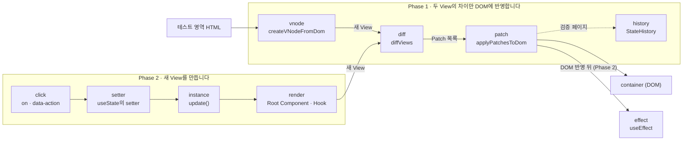

<!-- readme: archetype=team -->
# mini-react

Virtual DOM, Diff, Patch, Hooks를 바닐라 TypeScript로 직접 구현하면서 React가 이 기능들을 갖춘 이유를 이해하는 크래프톤 정글 팀 프로젝트입니다.

[](https://github.com/benjohnbill/mini-react/actions/workflows/ci.yml)

Status: active

## 실행

```bash
npm ci             # 도구 설치 (Node 버전: .nvmrc)
npm run dev        # 개발 서버에서 index.html 실행
npm run typecheck  # 타입 검사
npm run check      # 포맷, 린트, ADR이 인용한 테스트 ID 검사 (자동 수정: npm run format)
npm test           # 단위 테스트
npm run build      # 빌드
```

## Map (파일 지도)

```text
mini-react/
├── src/
│   ├── main.ts (entry)    페이지 시작 코드. index.html이 불러옴
│   ├── vnode.ts           VNode, DOM ↔ VNode 변환
│   ├── diff.ts            diffViews: 두 View → Patch 목록
│   ├── patch.ts           Patch 형식, applyPatchesToDom
│   ├── history.ts         StateHistory: 저장한 View 목록과 현재 위치
│   ├── function-component.ts  FunctionComponent, useState (Root Component를 감싸 mount와 update로 그림)
│   ├── test-pages/        검증 페이지와 데모 페이지 코드와 테스트
│   └── *.test.ts          테스트는 소스 옆에 둠
├── docs/adr/              되돌리기 어려운 결정과 이유. 폴더는 데이터가 지나가는 단계(docs/adr/README.md). 끝 두 줄의 ID = 지키는 테스트
├── docs/requirements/     LMS 문장마다 충족 판정과 근거 ADR (phase-1.md, phase-2.md)
├── scripts/
│   └── check-decision-links.mjs   ADR이 인용한 테스트 ID 확인. npm run check가 부름
├── .github/               PR 템플릿, CI(PR과 main push마다 검사)
├── GLOSSARY.md            코드와 문서의 이름
├── package.json           명령, 개발 도구. 런타임 의존성 없음. 설정은 tsconfig.json, biome.json, vitest.config.ts
└── AGENTS.md              에이전트 규칙. CLAUDE.md가 이 파일로 연결
```

## 다음에 읽을 것

- `CONVENTION.md`: 작업을 시작하기 전에 읽습니다.
- `AGENTS.md`: 에이전트에게 작업을 맡기기 전에 읽습니다.

Agents: if a path named here does not exist, report it to the owner.

## Architecture

이 저장소는 LMS 문장 → 결정(ADR) → 테스트 → 코드 순서로 따라 내려갈 수 있습니다. 이 절은 그 길을 Phase, 단계, 문장 하나의 순서로 보여 줍니다.

### Phase 1과 Phase 2

|         | 하는 일                                                         | 새 `View`를 만드는 것                           | LMS 문장                                                          |
| ------- | --------------------------------------------------------------- | ----------------------------------------------- | ----------------------------------------------------------------- |
| Phase 1 | 두 `View`(Virtual DOM)의 차이를 찾아, 그 차이만 DOM에 반영합니다 | 사람 (검증 페이지의 테스트 영역 HTML과 Patch 버튼) | S1 "Phase 1: Virtual DOM + Diff 알고리즘 + Patch"                 |
| Phase 2 | State가 바뀌면 새 `View`를 만들어 Phase 1에 넘깁니다             | 클릭이 바꾼 State                               | L14 "State 가 바뀌면 → 화면이 자동으로 다시 그려져야 합니다."     |

`View`는 화면 전체를 설명하는 값이고, LMS가 Virtual DOM이라 부르는 것입니다. 두 Phase는 `View`에서 만납니다. L20 "Phase 2 의 상태가 변경되어 다시 렌더링할 때, Phase 1 에서 만든 Virtual DOM 을 그대로 활용합니다."는 코드에서 `update()`가 `diffViews`와 `applyPatchesToDom`을 그대로 부르는 두 줄입니다.



### 단계

단계는 데이터가 지나가는 구간이고, `docs/adr/`의 폴더 이름과 같습니다. 결정은 그 결정을 지키는 테스트가 부르는 모듈의 단계에 둡니다.

| Phase | 단계 | 하는 일 | 대표 LMS 문장 | 닿는 LMS 문장 | ADR |
| ----- | ---- | ------- | ------------- | ------------- | --- |
| 1 | [`vnode`](docs/adr/vnode/README.md) | DOM과 `VNode`를 서로 바꿉니다 | S4 "브라우저의 DOM 정보를 읽어서 Virtual DOM 으로 변환하는 함수를 작성합니다." | 3 | 14 |
| 1 | [`diff`](docs/adr/diff/README.md) | 두 `View`를 비교해 `Patch` 목록을 만듭니다 | S5 "두 Virtual DOM 을 비교하여 변경된 부분을 찾아내는 Diff 알고리즘을 작성합니다." | 3 | 8 |
| 1 | [`patch`](docs/adr/patch/README.md) | `Patch` 목록을 DOM에 적용합니다 | S31 "Diff 알고리즘: 실제 DOM 에 반영 방법" | 9 | 9 |
| 1 | [`history`](docs/adr/history/README.md) | 저장한 `View`의 목록과 현재 위치를 가집니다 | S16 "새로 변경된 Virtual DOM 은 State History 에 저장합니다." | 2 | 5 |
| 2 | [`click`](docs/adr/click/README.md) | DOM 클릭을 `actions` 표의 함수 호출로 바꿉니다 | L26 "반드시 사용자의 입력/클릭 등에 따라 화면이 변경되어야 합니다." | 4 | 5 |
| 2 | [`setter`](docs/adr/setter/README.md) | 함수가 칸을 바꾸고 `update()`를 부릅니다 | L14 "State 가 바뀌면 → 화면이 자동으로 다시 그려져야 합니다." | 9 | 8 |
| 2 | [`instance`](docs/adr/instance/README.md) | Root Instance가 `mount`와 `update`로 한 번의 흐름을 지휘합니다 | L8 "update(): 상태 변경 후 다시 렌더링" | 10 | 6 |
| 2 | [`render`](docs/adr/render/README.md) | 칸을 읽어 Root Component를 실행하고 새 `View`를 만듭니다 | L6 "hooks 배열 (상태 저장용)" | 16 | 9 |
| 2 | [`effect`](docs/adr/effect/README.md) | DOM 반영 직후 effect와 정리 함수를 부릅니다 | L17 "최소 구현 대상: useEffect" | 4 | 8 |

- **닿는 LMS 문장:** 요구사항 표([Phase 1](docs/requirements/phase-1.md), [Phase 2](docs/requirements/phase-2.md))에서 그 단계의 ADR을 근거로 적은 문장의 수입니다.
- **ADR:** 대체된 ADR 2개를 뺀 수입니다. 흐름 밖의 폴더는 `verification-page` 16, `demo-page` 2, `team` 11입니다.

### LMS 문장 하나가 코드까지 내려가는 길

LMS L16은 "최소 구현 대상: useState" 한 줄입니다. 이 한 줄을 구현하려면 다섯 가지를 정해야 했고, 결정마다 ADR 하나와 테스트가 있습니다.

| 단계 | 결정 (ADR) | 모르고 쓰면 | 테스트 |
| ---- | ---------- | ----------- | ------ |
| `render` | [Hook의 칸은 렌더링마다 0부터 다시 세는 호출 순서로 찾습니다](docs/adr/render/hook-cells-are-found-by-call-order.md) | 조건에 따라 Hook 호출을 건너뛰면, 뒤쪽 Hook이 앞쪽 Hook의 칸 값을 받습니다 | F8, F17, F20, F21, F101, F102, F139, F42, F70 |
| `render` | [초깃값이 함수이면 첫 렌더링에서 한 번 불러 그 결과를 씁니다](docs/adr/render/initial-value-function-is-called-once.md) | `useState(myFn)`은 `myFn()`의 반환값을 저장합니다 | F17, F19 |
| `setter` | [setter에 함수를 넘기면 칸의 현재 값으로 불러 그 결과를 새 값으로 씁니다](docs/adr/setter/setter-accepts-updater-function.md) | `setFn(myFn)`은 `myFn(현재 값)`의 반환값을 저장합니다 | F23, F35, F38, F25 |
| `setter` | [새 값이 칸의 값과 같으면(`Object.is`) `update()`를 부르지 않습니다](docs/adr/setter/setter-skips-same-value.md) | 배열을 `push`로 고친 뒤 같은 배열을 넘기면 화면이 바뀌지 않습니다 | F18, F24, F27~F31, F33, F36, F32, F34 |
| `setter` | [칸에 새 값을 쓴 뒤 바로 `update()`를 부르고, 여러 호출을 모으지 않습니다 (범위)](docs/adr/setter/setter-updates-without-batching.md) | 클릭 한 번에 setter를 두 번 부르면 렌더링도 두 번 일어납니다 | F37, F35 |

코드는 `src/function-component.ts`의 `useState`와 `createStateCell`입니다. 네 번째 결정은 [Demo](#demo)의 순위 페이지에서 5점인 사람의 `+`를 누르면 볼 수 있습니다.

이 연결은 자동으로 검사합니다.

| 연결 | 검사 |
| ---- | ---- |
| LMS 문장 69개 → 근거 ADR 이름 | `npm run check`가 그 이름의 ADR 파일이 있는지 확인합니다 |
| ADR 101개 → 테스트 ID | `npm run check`가 인용한 ID(342개)가 테스트에 있는지 확인합니다 |
| 테스트 → 코드 | `npm test`. CI가 PR마다 실행합니다 |

### Core Data Structures

| 값 | 뜻 | 만드는 단계 → 쓰는 단계 |
| --- | --- | --- |
| `VNode` | 화면의 한 부분을 설명하는 값. 맨 위의 `VNode`가 `View`입니다 | `render`, `vnode` → `diff` |
| `Patch` | DOM에 반영할 지시 하나. `path`는 `View`에서 노드까지 내려가는 `children` 번호의 목록입니다 | `diff` → `patch` |
| `HookCell` | Hook 호출 하나의 값을 담는 칸. `hooks` 배열에 호출 순서대로 들어 있습니다 | `setter`, `render` → 다음 `render` |

```ts
type VNode =
  | string
  | { type: string; props: Record<string, string>; children: VNode[] };

type Patch =
  | { type: "TEXT"; path: number[]; text: string }
  | { type: "REPLACE"; path: number[]; node: VNode }
  | { type: "PROPS"; path: number[]; set: Record<string, string>; remove: string[] }
  | { type: "INSERT"; path: number[]; node: VNode }
  | { type: "REMOVE"; path: number[] };

type StateCell = { value: unknown; setter: StateSetter<unknown> };
type EffectCell = { deps: Deps | undefined; cleanup: Cleanup | undefined; version: number };
type MemoCell = { deps: Deps | undefined; value: unknown };
type HookCell = StateCell | EffectCell | MemoCell;
```

순위 페이지에서 6위인 사람의 `+`를 한 번 누른 뒤의 값입니다.

```text
hooks[0]  StateCell   value: { …, p06: 2 }                  1 → 2
hooks[3]  MemoCell    deps: [scores, track]                 scores가 바뀌어 다시 계산
hooks[4]  EffectCell  deps: ["p02"]                         1위가 그대로라 건너뜀

patches   { type: "TEXT", path: [0, 1, 5, 3, 0], text: "2" }   동료 평가의 점수
          { type: "TEXT", path: [1, 3, 5, 2, 0], text: "2" }   순위표의 점수
```

## Demo

### Main Demo: 순위 페이지

<!-- 녹화한 GIF를 docs/images/ranking-page.gif에 넣은 뒤 아래 줄의 주석을 풉니다.

-->

순위 페이지는 동료 평가의 점수를 누르면 순위가 바뀌는 화면입니다. 오른쪽의 Hook 패널은 클릭마다 그 클릭이 지난 단계, `hooks`의 칸마다 일어난 일, DOM에 적용한 `Patch` 목록을 보여 줍니다. `npm run dev`를 실행한 뒤 `http://localhost:5173/#ranking-section`에서 볼 수 있습니다.

| 클릭 | 지난 단계 | `useMemo` | `useEffect` | `Patch` |
| ---- | --------- | --------- | ----------- | ------- |
| 이름 가리기 | `click` ~ `patch` | 건너뜀 | 건너뜀 | `PROPS` 1, `TEXT` 7 |
| 순위가 그대로인 점수 `+` | `click` ~ `patch` | 다시 계산 | 건너뜀 | `TEXT` 2 |
| 1위가 바뀌는 점수 `+` | `click` ~ `effect` | 다시 계산 | 실행 | `TEXT` 6 |
| 5점인 사람의 `+` | `click`, `setter` | | | 없음 |

코드는 `src/test-pages/ranking-page.ts`(Root Component)와 `src/test-pages/hook-panel.ts`(Hook 패널)이고, 위 표의 줄은 테스트 K3, K4, K5, K6, K8이 확인합니다.

### Vanilla, mini-react, React의 차이

1위가 바뀌는 클릭 한 번에 순위표의 DOM에 하는 일입니다.

| | DOM에 하는 일 |
| --- | --- |
| Vanilla (`innerHTML`) | 순위표의 줄을 모두 새로 만듭니다 |
| mini-react | 줄은 그대로 두고, 자리가 바뀐 두 줄의 글자를 고칩니다 (`TEXT` 6) |
| React (`key`) | 글자는 그대로 두고, 줄을 옮깁니다 |

mini-react는 `key`가 없어 같은 번호의 자식끼리 비교합니다([`diff-compares-same-index-children-first`](docs/adr/diff/diff-compares-same-index-children-first.md)). mini-react의 줄은 테스트 K5가 확인합니다. Vanilla와 React의 줄은 이 저장소에서 재지 않았습니다.

## Root Component를 쓸 때

Root Component 본문은 렌더링마다 처음부터 다시 실행됩니다. 그래서 아래 규칙을 지켜야 칸과 화면이 어긋나지 않습니다.

| 규칙 | 어기면 | 알려 주는 곳 |
| ---- | ------ | ------------ |
| Hook은 Root Component 본문 맨 위에서, 매번 같은 순서로 부릅니다 | 뒤쪽 Hook이 앞쪽 칸의 값을 받습니다 | Biome `useHookAtTopLevel` |
| 클릭 함수 안에서는 Hook을 부르지 않고, 렌더링 때 받은 값과 setter를 씁니다 | `Error` | 실행할 때, Biome |
| 렌더링 중에는 setter를 부르지 않습니다 | `Error` | 실행할 때 |
| 자식 Component는 `function create<이름>` 선언으로 쓰고, Hook을 쓰지 않습니다 | 자식을 빼면 뒤쪽 Hook의 칸이 밀립니다 | Biome (`function` 선언일 때), 리뷰 |
| Root Component는 PascalCase로 짓습니다 (예: `CounterRootComponent`) | Biome이 클릭 함수 안의 Hook을 놓칩니다 | 리뷰 |
| 본문에서 DOM을 직접 고치지 않습니다 | 다음 Patch가 그 변경을 몰라 화면이 View와 어긋납니다 | 리뷰 |

근거 ADR (`docs/adr/` 아래): `render/hook-cells-are-found-by-call-order`, `render/hook-outside-render-throws-error`, `setter/setter-during-render-throws-error`, `render/hook-rule-kept-by-convention`, `team/hook-position-checked-by-lint`, `instance/component-returns-view-and-function-component-draws`.

## 팀

| GitHub 계정   | 브랜치    |
| :------------ | :-------- |
| `benjohnbill` | `CJG`     |
| `oyatmin1031` | 직접 생성 |
| `DavinAn6`    | `Davin`   |

## 마일스톤 범위

마일스톤과 할 일은 팀 보드에 있습니다: https://github.com/users/benjohnbill/projects/7

## 규칙

브랜치, PR, 커밋, 병합 규칙과, ADR의 결정과 테스트를 잇는 규칙은 `CONVENTION.md`에 있습니다.

## 시작하기

```bash
git clone https://github.com/benjohnbill/mini-react.git
cd mini-react
git switch -c <이니셜>
git push -u origin <이니셜>
npm ci
npm test
```


## Getting Started

Node.js **26**이 필요합니다(`.nvmrc` 기준). 저장소를 내려받고 개발 서버를 실행하세요.

```bash
git clone https://github.com/benjohnbill/mini-react.git
cd mini-react
npm ci
npm run dev
```

### Hello World

Root Component는 화면을 설명하는 `VNode`를 돌려주는 함수입니다. 문자열도 VNode이므로 다음 코드만으로 첫 화면을 그릴 수 있습니다.

[docs/examples/hello-world/main.ts](docs/examples/hello-world/main.ts):

아래 상대 import 경로는 `docs/examples/hello-world/` 기준입니다.

```ts
import { FunctionComponent } from "../../../src/function-component";

const container = document.querySelector("#app");
if (container === null) {
  throw new Error("#app 요소가 필요합니다");
}

new FunctionComponent(() => "Hello World").mount(container);
```

HTML에는 화면을 그릴 요소와 TypeScript 파일을 불러오는 코드가 필요합니다. 위 코드는 이미 저장소에 있으므로 파일을 수정하지 않고 실행할 수 있습니다. 아래는 실행에 필요한 [index.html](docs/examples/hello-world/index.html)입니다.

```html
<!doctype html>
<html lang="ko">
  <head>
    <meta charset="UTF-8" />
    <meta name="viewport" content="width=device-width, initial-scale=1" />
    <title>Hello World | mini-react</title>
    <link rel="stylesheet" href="../examples.css" />
  </head>
  <body>
    <main>
      <div id="app"></div>
    </main>
    <script type="module" src="./main.ts"></script>
  </body>
</html>
```

개발 서버를 실행한 뒤 브라우저에서 `http://localhost:5173/docs/examples/hello-world/`를 여세요. 화면에 `Hello World`가 표시됩니다. 포트가 다르면 `5173`을 터미널에 표시된 포트로 바꾸세요.


### 더 많은 예제

[예제 모음](docs/examples/README.md)에서 mini-react의 주요 기능을 사용하는 더 많은 예제를 확인할 수 있습니다.
