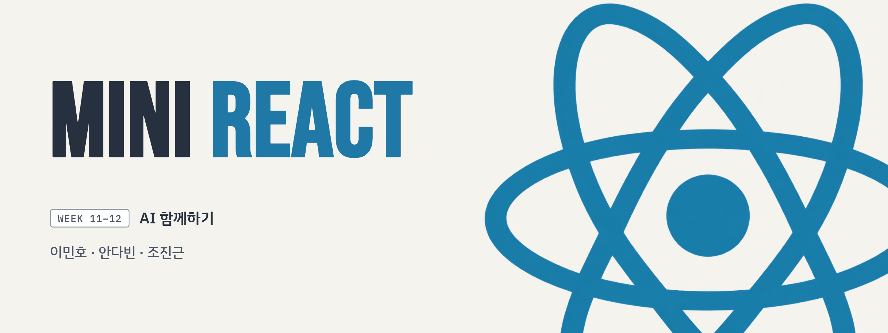
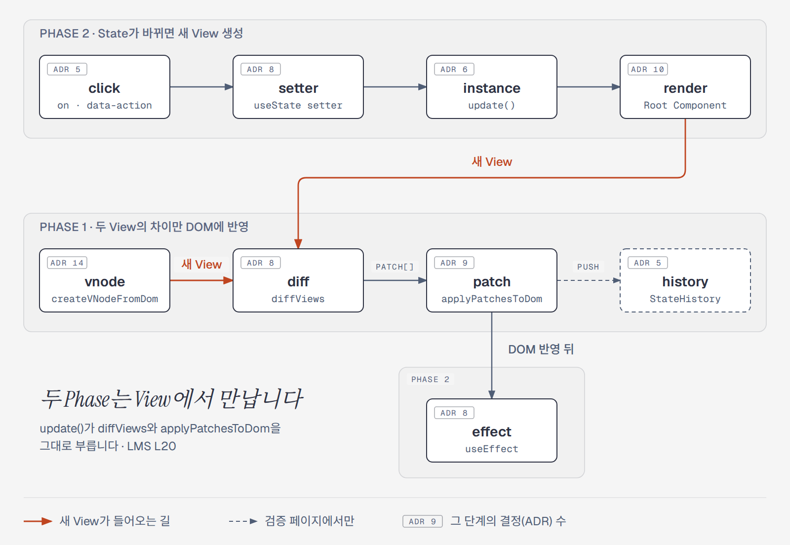
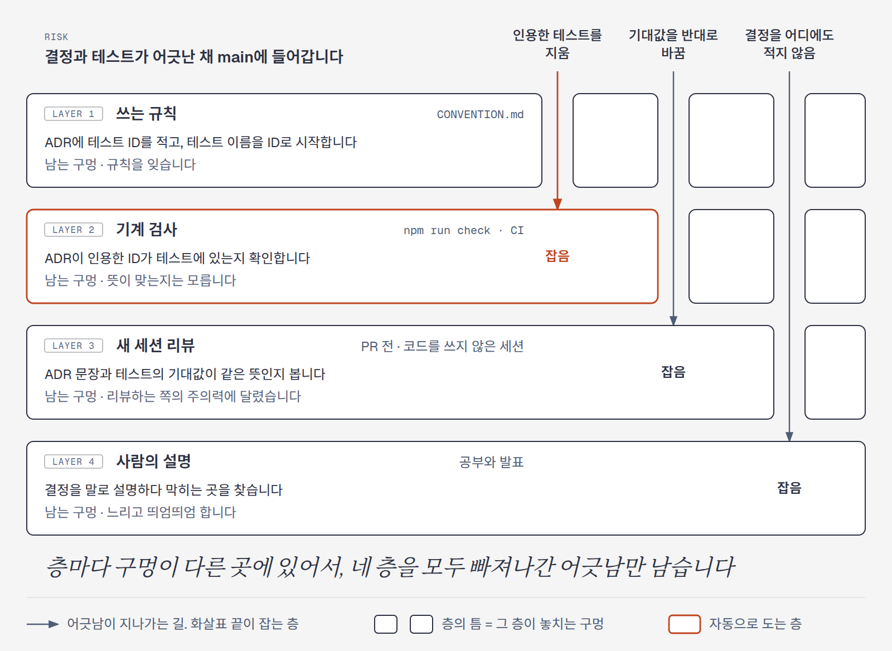

<!-- readme: archetype=team -->
<p align="center">
  
</p>

[](https://github.com/benjohnbill/mini-react/actions/workflows/ci.yml)
[](https://github.com/benjohnbill/mini-react/actions/workflows/deploy-pages.yml)
[](https://benjohnbill.github.io/mini-react/)


[Overview](#overview) · [Architecture](#architecture) · [Validation](#validation) · [Demo](#demo) · [Getting Started](#getting-started) · [Environment](#environment) · [Team](#team)


## Overview

mini-react는 Virtual DOM, Diff, Patch, Hooks를 바닐라 TypeScript로 구현하고, LMS 요구사항 문장마다 결정(ADR)과 테스트를 이어 그 연결을 `npm run check`로 검사하는 저장소입니다.

**mini-react란?**
- React 없이 Virtual DOM, Diff, Patch, Hooks를 바닐라 TypeScript로 직접 구현한 프로젝트
- React의 핵심 흐름만 남긴 간소화 버전
- 구조를 단순하게 유지해서 코드를 따라 읽기만 해도 핵심 로직 파악 가능

**지원하는 것**
- 함수형 컴포넌트로 화면 렌더링
- `useState`, `useEffect`, `useMemo`
- State가 바뀌면 이전 화면과 비교해서 바뀐 부분만 DOM에 반영

**핵심 용어**
- **View**: 화면 전체를 설명하는 값 (= Virtual DOM)
- **Patch**: 두 View의 차이를 DOM에 반영하기 위한 지시
- **Root Component**: State를 가질 수 있는 최상위 함수형 컴포넌트
- **칸(`HookCell`)**: Hook 호출 하나의 값을 담는 자리. `hooks` 배열에 호출 순서대로 저장

**React와 다른 점**
- State와 Hook은 최상위 컴포넌트에서만 사용 가능. 자식 컴포넌트는 props만 받음
- 이벤트는 클릭만 지원
- `key` 없음. 자식 요소는 같은 순서끼리 비교
- 여러 번의 setState를 한 번에 묶어 처리하는 Batching 없음
- 컴포넌트가 화면에서 사라질 때(unmount) 정리하는 기능 없음


## Architecture

이 저장소는 LMS 문장 → 결정(ADR) → 테스트 → 코드 순서로 따라 내려갈 수 있습니다. 이 절은 그 길을 Phase와 문장 하나의 순서로 보여 줍니다.

### Phase 1과 Phase 2

|         | 하는 일                                                         | 새 `View`를 만드는 것                           | LMS 문장                                                          |
| ------- | --------------------------------------------------------------- | ----------------------------------------------- | ----------------------------------------------------------------- |
| Phase 1 | 두 `View`(Virtual DOM)의 차이를 찾아, 그 차이만 DOM에 반영합니다 | 사람 (검증 페이지의 테스트 영역 HTML과 Patch 버튼) | S1 "Phase 1: Virtual DOM + Diff 알고리즘 + Patch"                 |
| Phase 2 | State가 바뀌면 새 `View`를 만들어 Phase 1에 넘깁니다             | 클릭이 바꾼 State                               | L14 "State 가 바뀌면 → 화면이 자동으로 다시 그려져야 합니다."     |

`View`는 화면 전체를 설명하는 값이고, LMS가 Virtual DOM이라 부르는 것입니다. 두 Phase는 `View`에서 만납니다. L20 "Phase 2 의 상태가 변경되어 다시 렌더링할 때, Phase 1 에서 만든 Virtual DOM 을 그대로 활용합니다."는 코드에서 `update()`가 `diffViews`와 `applyPatchesToDom`을 그대로 부르는 두 줄입니다.



상자의 `ADR` 숫자는 그 단계의 결정 수입니다. 그림의 원본은 `docs/images/architecture.html`입니다.

### LMS 문장 하나가 코드까지 내려가는 길

LMS L16은 "최소 구현 대상: useState" 한 줄입니다. 이 한 줄을 구현하려면 다섯 가지를 정해야 했고, 결정마다 ADR 하나와 테스트가 있습니다.

| 단계 | 결정 (ADR) | 모르고 쓰면 | 테스트 |
| ---- | ---------- | ----------- | ------ |
| `render` | [Hook의 칸은 렌더링마다 0부터 다시 세는 호출 순서로 찾습니다](docs/adr/render/hook-cells-are-found-by-call-order.md) | 조건에 따라 Hook 호출을 건너뛰면, 뒤쪽 Hook이 앞쪽 Hook의 칸 값을 받습니다 | F8, F17, F20, F21, F101, F102, F139, F42, F70 |
| `render` | [초깃값이 함수이면 첫 렌더링에서 한 번 불러 그 결과를 씁니다](docs/adr/render/initial-value-function-is-called-once.md) | `useState(myFn)`은 `myFn()`의 반환값을 저장합니다 | F17, F19 |
| `setter` | [setter에 함수를 넘기면 칸의 현재 값으로 불러 그 결과를 새 값으로 씁니다](docs/adr/setter/setter-accepts-updater-function.md) | `setFn(myFn)`은 `myFn(현재 값)`의 반환값을 저장합니다 | F23, F35, F38, F25 |
| `setter` | [새 값이 칸의 값과 같으면(`Object.is`) `update()`를 부르지 않습니다](docs/adr/setter/setter-skips-same-value.md) | 배열을 `push`로 고친 뒤 같은 배열을 넘기면 화면이 바뀌지 않습니다 | F18, F24, F27~F31, F33, F36, F32, F34 |
| `setter` | [칸에 새 값을 쓴 뒤 바로 `update()`를 부르고, 여러 호출을 모으지 않습니다 (범위)](docs/adr/setter/setter-updates-without-batching.md) | 클릭 한 번에 setter를 두 번 부르면 렌더링도 두 번 일어납니다 | F37, F35 |

코드는 `src/function-component.ts`의 `useState`와 `createStateCell`입니다. 네 번째 결정은 [Demo](#demo)의 순위 페이지에서 5점인 사람의 `+`를 누르면 볼 수 있습니다.

단계 9개의 정의와 ADR 수, `VNode`와 `Patch`와 `HookCell`의 타입은 [docs/architecture.md](docs/architecture.md)에 있습니다.


## Validation

LMS 문장 → ADR → 테스트 → 코드의 연결은 자동으로 검사합니다.

| 연결 | 검사 |
| ---- | ---- |
| LMS 문장 69개 → 근거 ADR 이름 | `npm run check`가 그 이름의 ADR 파일이 있는지 확인합니다 |
| ADR 101개 → 테스트 ID | `npm run check`가 인용한 ID(342개)가 테스트에 있는지 확인합니다 |
| 테스트 → 코드 | `npm test`. CI가 PR마다 실행합니다 |

ADR이 인용한 테스트 ID 하나를 테스트에 없는 ID로 바꾸면 `npm run check`가 실패합니다.

```text
[실패] docs/adr/setter/setter-updates-without-batching.md: 테스트에 없는 ID를 인용했습니다: F9999
```

### 결정과 테스트를 잇는 네 층

자동 검사는 ID가 있는지만 봅니다. 결정과 테스트의 뜻이 맞는지는 모릅니다. 그래서 놓치는 곳이 서로 다른 네 층을 겹칩니다(Swiss cheese model).



| 층 | 있는 곳 |
| --- | --- |
| 쓰는 규칙 | `CONVENTION.md`의 "결정과 테스트 잇기", "ADR 쓰기" |
| 기계 검사 | `scripts/check-decision-links.mjs`. `npm run check`와 CI가 부릅니다 |
| 새 세션 리뷰 | `CONVENTION.md`의 "에이전트". 결과는 PR 본문의 `새 세션 리뷰`에 적습니다 (예: 커밋 `08bbe4a`가 리뷰를 반영해 ADR의 인용을 바로잡았습니다) |
| 사람의 설명 | `CONVENTION.md` 6번. 병합된 코드는 원리를 말로 설명할 수 있어야 합니다 |

그림의 원본은 `docs/images/validation-layers.html`입니다.


## Demo

### Main Demo: 순위 페이지

<!-- 녹화한 GIF를 docs/images/ranking-page.gif에 넣은 뒤 아래 줄의 주석을 풉니다.

-->

순위 페이지는 동료 평가의 점수를 누르면 순위가 바뀌는 화면입니다. 오른쪽의 Hook 패널은 클릭마다 그 클릭이 지난 단계, `hooks`의 칸마다 일어난 일, DOM에 적용한 `Patch` 목록을 보여 줍니다. `npm run dev`를 실행한 뒤 `http://localhost:5173/#ranking-section`에서 볼 수 있습니다.

| 클릭 | 지난 단계 | `useMemo` | `useEffect` | `Patch` |
| ---- | --------- | --------- | ----------- | ------- |
| 이름 가리기 | `click` ~ `patch` | 건너뜀 | 건너뜀 | `PROPS` 1, `TEXT` 7 |
| 순위가 그대로인 점수 `+` | `click` ~ `patch` | 다시 계산 | 건너뜀 | `TEXT` 2 |
| 1위가 바뀌는 점수 `+` | `click` ~ `effect` | 다시 계산 | 실행 | `TEXT` 6 |
| 5점인 사람의 `+` | `click`, `setter` | | | 없음 |

코드는 `src/test-pages/ranking-page.ts`(Root Component)와 `src/test-pages/hook-panel.ts`(Hook 패널)이고, 위 표의 줄은 테스트 K3, K4, K5, K6, K8이 확인합니다.

### Vanilla, mini-react, React의 차이

1위가 바뀌는 클릭 한 번에 순위표의 DOM에 하는 일입니다.

| | DOM에 하는 일 |
| --- | --- |
| Vanilla (`innerHTML`) | 순위표의 줄을 모두 새로 만듭니다 |
| mini-react | 줄은 그대로 두고, 자리가 바뀐 두 줄의 글자를 고칩니다 (`TEXT` 6) |
| React (`key`) | 글자는 그대로 두고, 줄을 옮깁니다 |

mini-react는 `key`가 없어 같은 번호의 자식끼리 비교합니다([`diff-compares-same-index-children-first`](docs/adr/diff/diff-compares-same-index-children-first.md)). mini-react의 줄은 테스트 K5가 확인합니다. Vanilla와 React의 줄은 이 저장소에서 재지 않았습니다.

## Getting Started

### 설치 및 실행
Node.js **26**이 필요합니다(`.nvmrc` 기준). 저장소를 내려받고 개발 서버를 실행하세요.

```bash
git clone https://github.com/benjohnbill/mini-react.git
cd mini-react
npm ci             # 도구 설치 (Node 버전: .nvmrc)
npm run dev        # 개발 서버에서 index.html 실행
npm run typecheck  # 타입 검사
npm run check      # 포맷, 린트, ADR이 인용한 테스트 ID 검사 (자동 수정: npm run format)
npm test           # 단위 테스트
npm run build      # 빌드
```


### Hello World

Root Component는 화면을 설명하는 `VNode`를 돌려주는 함수입니다. 문자열도 VNode이므로 다음 코드만으로 첫 화면을 그릴 수 있습니다.

[docs/examples/hello-world/main.ts](docs/examples/hello-world/main.ts):

아래 상대 import 경로는 `docs/examples/hello-world/` 기준입니다.

```ts
import { FunctionComponent } from "../../../src/function-component";

const container = document.querySelector("#app");
if (container === null) {
  throw new Error("#app 요소가 필요합니다");
}

new FunctionComponent(() => "Hello World").mount(container);
```

HTML은 [index.html](docs/examples/hello-world/index.html)에 있습니다. 파일을 고치지 않고 실행할 수 있습니다.

개발 서버를 실행한 뒤 브라우저에서 `http://localhost:5173/docs/examples/hello-world/`를 여세요. 화면에 `Hello World`가 표시됩니다. 포트가 다르면 `5173`을 터미널에 표시된 포트로 바꾸세요.


### 더 많은 예제

[예제 모음](docs/examples/README.md)에서 mini-react의 주요 기능을 사용하는 더 많은 예제를 확인할 수 있습니다.

Root Component를 쓸 때 지킬 규칙 여섯 개는 [docs/root-component-rules.md](docs/root-component-rules.md)에 있습니다.

## Environment
### Tech Stack
| 구분 | 도구 | 용도 |
| --- | --- | --- |
| Language | TypeScript 7 | `strict`, `noUncheckedIndexedAccess` 켜고 사용 |
| Runtime | Node.js 26 | 버전은 `.nvmrc` 기준 |
| Dev Server / Build | Vite 8 | 개발 서버, 데모 페이지 빌드 |
| Test | Vitest 5 + jsdom | 단위 테스트, 기능 테스트. jsdom으로 브라우저 DOM 환경 재현 |
| Lint / Format | Biome 2 | 코드 형식 통일, 실수 자동 검사 |
| CI | GitHub Actions | PR과 main push마다 typecheck → check → test → build 실행 |
| Deploy | GitHub Pages | main에 머지되면 데모 페이지 자동 배포 |


### Project Structure
```text
mini-react/
├── src/
│   ├── main.ts                진입점. index.html이 불러옴
│   ├── vnode.ts               VNode 타입, DOM ↔ VNode 변환
│   ├── diff.ts                diffViews: 두 View 비교 → Patch 목록
│   ├── patch.ts               applyPatchesToDom: Patch 목록을 DOM에 반영
│   ├── history.ts             StateHistory: 뒤로가기 / 앞으로가기
│   ├── function-component.ts  FunctionComponent, useState / useEffect / useMemo
│   ├── test-pages/            검증 페이지, 데모 페이지
│   └── *.test.ts              테스트 (소스 옆에 둠)
├── docs/
│   ├── examples/              Hello World 등 사용 예제
│   └── adr/                   설계 결정과 이유
├── index.html                 데모 페이지
└── GLOSSARY.md                코드와 문서에서 쓰는 용어 정리
```


## Team

| GitHub 계정   | 이름 | 브랜치    | 
| :------------ | :--- | :-------- |
| `benjohnbill` | 조진근 | `CJG`     |
| `oyatmin1031` | 이민호 | (확인 필요) |
| `DavinAn6`    | 안다빈 | `Davin`   |


### 작업 규칙
- `CONVENTION.md`: 브랜치, PR, 커밋, 병합 규칙. 작업 시작 전에 읽음
- `AGENTS.md`: 에이전트에게 작업을 맡기기 전에 읽음
- 마일스톤과 할 일: [팀 보드](https://github.com/users/benjohnbill/projects/7)