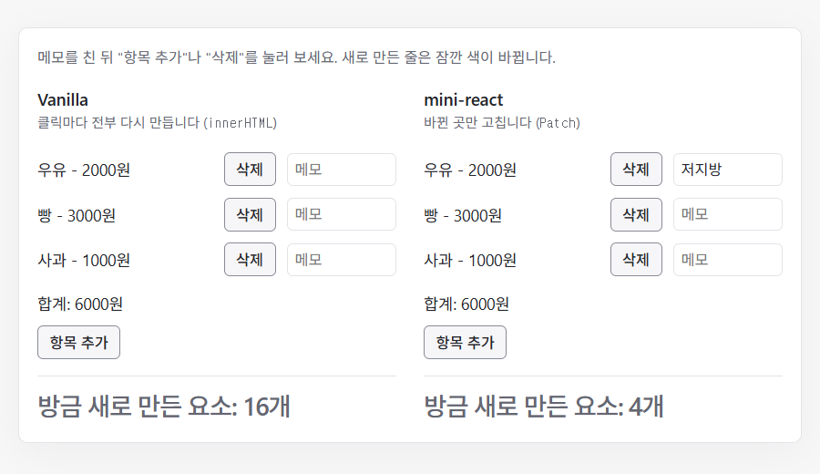

<!-- readme: archetype=team -->
<p align="center">
  
</p>

[](https://github.com/benjohnbill/mini-react/actions/workflows/ci.yml)
[](https://github.com/benjohnbill/mini-react/actions/workflows/deploy-pages.yml)
[](https://benjohnbill.github.io/mini-react/)


[Getting Started](#getting-started) · [Top-Down 작업과정](#top-down-작업과정) · [Architecture](#architecture) · [Validation](#validation) · [Demo](#demo) · [Examples](#examples) · [Environment](#environment) · [Team](#team)


## Getting Started

### 설치 및 실행
Node.js **26**이 필요합니다(`.nvmrc` 기준). 저장소를 내려받고 개발 서버를 실행하세요.

```bash
git clone https://github.com/benjohnbill/mini-react.git
cd mini-react
npm ci             # 도구 설치 (Node 버전: .nvmrc)
npm run dev        # 개발 서버에서 index.html 실행
npm run typecheck  # 타입 검사
npm run check      # 포맷, 린트, ADR이 인용한 테스트 ID 검사 (자동 수정: npm run format)
npm test           # 단위 테스트
npm run build      # 빌드
```


## Top-Down 작업과정

LMS 문장 → 결정(ADR) → 테스트 → 코드 순서로 작업했습니다. LMS 문장 하나로 그 순서를 보여 줍니다.

> "각각의 Component 는 자신만의 **로직**과 **렌더링**을 담당합니다." (LMS L3)

"로직"과 "렌더링"의 뜻을 용어집 [`GLOSSARY.md`](GLOSSARY.md)에 정하고, 그 뜻에서 결정(ADR)을 한 문장씩 썼습니다.

| 단어 | 결정 (ADR) |
| ---- | ---------- |
| 렌더링 | [`update()`는 Root Component 본문을 처음부터 다시 실행해 새 View를 만듭니다](docs/adr/render/update-reruns-root-component-and-makes-new-view.md) |
| Component의 로직 | [`update()`는 Root Component 본문을 다시 실행하면서 클릭 함수도 새로 만들어, 이전 렌더링의 클릭 함수를 모두 바꿉니다](docs/adr/render/update-makes-new-click-functions.md) |

결정이 한 문장이면 무엇을 테스트할지가 정해집니다. 두 결정의 테스트와 코드는 [docs/l3-tests-and-code.md](docs/l3-tests-and-code.md)에 있습니다.


## Architecture

### Data Flow

`View`는 화면 전체를 설명하는 값이고, LMS가 Virtual DOM이라 부르는 것입니다. 두 Phase는 `View`에서 만납니다. L20 "Phase 2 의 상태가 변경되어 다시 렌더링할 때, Phase 1 에서 만든 Virtual DOM 을 그대로 활용합니다."는 코드에서 `update()`가 `diffViews`와 `applyPatchesToDom`을 그대로 부르는 두 줄입니다.


상자의 `ADR` 숫자는 그 단계의 결정 수입니다. 그림의 원본은 `docs/images/architecture.html`입니다.

단계 9개의 정의와 ADR 수, L16 "useState" 한 줄이 결정 다섯 개로 퍼지는 표, `VNode`와 `Patch`와 `HookCell`의 타입은 [docs/architecture.md](docs/architecture.md)에 있습니다.


## Validation


그림의 원본은 `docs/images/validation-layers.html`입니다.


## Demo

### Vanilla와 mini-react: 장보기 목록

같은 장보기 목록을 두 판으로 나란히 만들었습니다. Vanilla 판은 클릭마다 `innerHTML`로 전부 다시 만들고, mini-react 판은 바뀐 곳만 고칩니다. 판 아래의 숫자는 그 클릭에 새로 만든 요소의 수와 태그별 내역이고, mini-react 판 아래에는 그 클릭의 `Patch` 목록이 나옵니다. 새로 만든 줄은 잠깐 색이 바뀝니다. `npm run dev`를 실행한 뒤 `http://localhost:5173/examples/shopping-list/`에서 볼 수 있습니다.



| 동작 | Vanilla (`innerHTML`) | mini-react | 테스트 |
| ---- | --------------------- | ---------- | ------ |
| "항목 추가"를 누릅니다 | 요소 16개를 새로 만듭니다 (줄 셋과 합계와 버튼 전부) | 요소 4개를 새로 만듭니다 (새 줄 하나) | E7, E8 |
| 메모를 친 뒤 "항목 추가"를 누릅니다 | 입력란을 새로 만들어 친 메모가 사라집니다 | 같은 입력란이라 친 메모가 남습니다 | E7, E8 |
| "항목 추가"에 포커스를 두고 누릅니다 | 버튼을 새로 만들어 포커스를 잃습니다 | 같은 버튼이라 포커스가 남습니다 | E7, E8 |
| 메모를 친 뒤 맨 아래 항목을 "삭제"합니다 | 남은 줄도 새로 만들어 친 메모가 사라집니다 | 맨 아래 줄만 지워 친 메모가 남습니다 | E10 |
| 첫 줄에 메모를 친 뒤 첫 항목을 "삭제"합니다 | 친 메모가 사라집니다 | 친 메모가 첫 줄에 남아 다음 항목 옆에 보입니다 | E9 |

마지막 줄은 mini-react의 한계입니다. `key`가 없어 같은 번호의 자식끼리 비교하므로([`diff-compares-same-index-children-first`](docs/adr/diff/diff-compares-same-index-children-first.md)), 입력란은 항목을 따라가지 않고 자리에 남습니다. React는 `key`로 줄을 옮겨 입력란이 항목을 따라갑니다. React의 동작은 이 저장소에서 재지 않았습니다. 코드와 설명은 [`examples/shopping-list/`](examples/shopping-list/README.md)에 있습니다.


## Examples

### Hello World

Root Component는 화면을 설명하는 `VNode`를 돌려주는 함수입니다. 문자열도 VNode이므로 다음 코드만으로 첫 화면을 그릴 수 있습니다.

[examples/hello-world/main.ts](examples/hello-world/main.ts):

아래 상대 import 경로는 `examples/hello-world/` 기준입니다.

```ts
import { FunctionComponent } from "../../src/function-component";

const container = document.querySelector("#app");
if (container === null) {
  throw new Error("#app 요소가 필요합니다");
}

new FunctionComponent(() => "Hello World").mount(container);
```

HTML은 [index.html](examples/hello-world/index.html)에 있습니다. 파일을 고치지 않고 실행할 수 있습니다.

개발 서버를 실행한 뒤 브라우저에서 `http://localhost:5173/examples/hello-world/`를 여세요. 화면에 `Hello World`가 표시됩니다. 포트가 다르면 `5173`을 터미널에 표시된 포트로 바꾸세요.


### 더 많은 예제

[예제 모음](examples/README.md)에서 mini-react의 주요 기능을 사용하는 더 많은 예제를 확인할 수 있습니다.

Root Component를 쓸 때 지킬 규칙 여섯 개는 [docs/root-component-rules.md](docs/root-component-rules.md)에 있습니다.

## Environment
### Tech Stack
| 구분 | 도구 | 용도 |
| --- | --- | --- |
| Language | TypeScript 7 | `strict`, `noUncheckedIndexedAccess` 켜고 사용 |
| Runtime | Node.js 26 | 버전은 `.nvmrc` 기준 |
| Dev Server / Build | Vite 8 | 개발 서버, 데모 페이지 빌드 |
| Test | Vitest 5 + jsdom | 단위 테스트, 기능 테스트. jsdom으로 브라우저 DOM 환경 재현 |
| Lint / Format | Biome 2 | 코드 형식 통일, 실수 자동 검사 |
| CI | GitHub Actions | PR과 main push마다 typecheck → check → test → build 실행 |
| Deploy | GitHub Pages | main에 머지되면 데모 페이지 자동 배포 |


### Project Structure
```text
mini-react/
├── src/
│   ├── main.ts                진입점. index.html이 불러옴
│   ├── vnode.ts               VNode 타입, DOM ↔ VNode 변환
│   ├── diff.ts                diffViews: 두 View 비교 → Patch 목록
│   ├── patch.ts               applyPatchesToDom: Patch 목록을 DOM에 반영
│   ├── history.ts             StateHistory: 뒤로가기 / 앞으로가기
│   ├── function-component.ts  FunctionComponent, useState / useEffect / useMemo
│   ├── test-pages/            검증 페이지, 데모 페이지
│   └── *.test.ts              테스트 (소스 옆에 둠)
├── examples/                 Hello World 등 실행 가능한 사용 예제
├── docs/
│   └── adr/                   설계 결정과 이유
├── index.html                 데모 페이지
└── GLOSSARY.md                코드와 문서에서 쓰는 용어 정리
```


## Team

| GitHub 계정   | 이름 | 브랜치    | 
| :------------ | :--- | :-------- |
| `benjohnbill` | 조진근 | `CJG`     |
| `oyatmin1031` | 이민호 | (확인 필요) |
| `DavinAn6`    | 안다빈 | `Davin`   |


### 작업 규칙
- `CONVENTION.md`: 브랜치, PR, 커밋, 병합 규칙. 작업 시작 전에 읽음
- `AGENTS.md`: 에이전트에게 작업을 맡기기 전에 읽음
- 마일스톤과 할 일: [팀 보드](https://github.com/users/benjohnbill/projects/7)