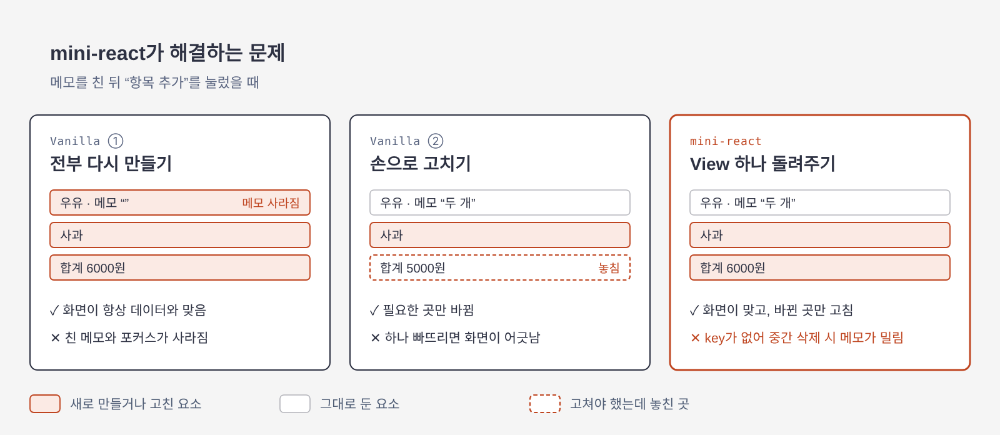

<!-- readme: archetype=team -->
<p align="center">
  
</p>

[](https://github.com/benjohnbill/mini-react/actions/workflows/ci.yml)
[](https://github.com/benjohnbill/mini-react/actions/workflows/deploy-pages.yml)
[](https://benjohnbill.github.io/mini-react/)


[Getting Started](#getting-started) · [Top-Down 작업과정](#top-down-작업과정) · [Architecture](#architecture) · [Validation](#validation) · [Why Mini-React?](#why-mini-react) · [Environment](#environment) · [Team](#team)


## Getting Started

### 설치 및 실행
Node.js **26**이 필요합니다(`.nvmrc` 기준). 저장소를 내려받고 개발 서버를 실행하세요.

```bash
git clone https://github.com/benjohnbill/mini-react.git
cd mini-react
npm ci             # 도구 설치 (Node 버전: .nvmrc)
npm run dev        # 개발 서버에서 index.html 실행
npm run typecheck  # 타입 검사
npm run check      # 포맷, 린트, ADR이 인용한 테스트 ID 검사 (자동 수정: npm run format)
npm test           # 단위 테스트
npm run build      # 빌드
```


## Top-Down 작업과정

이 저장소는 LMS 문장 → 결정(ADR) → 테스트 → 코드 순서로 따라 내려갈 수 있습니다. LMS 문장 하나로 그 길을 보여 줍니다.

> "각각의 Component 는 자신만의 **로직**과 **렌더링**을 담당합니다." (LMS L3)

"로직"과 "렌더링"의 뜻은 용어집 [`GLOSSARY.md`](GLOSSARY.md)에 있고, 두 단어에 답하는 결정(ADR)은 한 문장씩입니다.

| 단어 | 결정 (ADR) |
| ---- | ---------- |
| 렌더링 | [Component는 View를 돌려주기까지만 하고, DOM에 그리는 일은 `FunctionComponent`의 `mount()`와 `update()`가 합니다](docs/adr/instance/component-returns-view-and-function-component-draws.md) |
| Component의 로직 | [Root Component만 `FunctionComponent`로 감싸고, 자식 Component는 props를 받아 `VNode`를 돌려주는 함수로 둡니다](docs/adr/render/root-only-function-component.md) |

LMS L10 "State 는 최상위 컴포넌트에서만 관리합니다"에 따라, 로직은 Root Component만 가집니다.

결정이 한 문장이면 무엇을 테스트할지가 정해집니다. 두 결정의 테스트와 코드는 [docs/l3-tests-and-code.md](docs/l3-tests-and-code.md)에 있습니다.


## Architecture

### Project Structure
```text
mini-react/
├── src/
│   ├── main.ts                진입점. index.html이 불러옴
│   ├── vnode.ts               VNode 타입, DOM ↔ VNode 변환
│   ├── diff.ts                diffViews: 두 View 비교 → Patch 목록
│   ├── patch.ts               applyPatchesToDom: Patch 목록을 DOM에 반영
│   ├── history.ts             StateHistory: 뒤로가기 / 앞으로가기
│   ├── function-component.ts  FunctionComponent, useState / useEffect / useMemo
│   ├── test-pages/            검증 페이지, 데모 페이지
│   └── *.test.ts              테스트 (소스 옆에 둠)
├── examples/                 Hello World 등 실행 가능한 사용 예제
├── docs/
│   └── adr/                   설계 결정과 이유
├── index.html                 데모 페이지
└── GLOSSARY.md                코드와 문서에서 쓰는 용어 정리
```

### Data Flow

`View`는 화면 전체를 설명하는 값이고, LMS가 Virtual DOM이라 부르는 것입니다. 두 Phase는 `View`에서 만납니다. L20 "Phase 2 의 상태가 변경되어 다시 렌더링할 때, Phase 1 에서 만든 Virtual DOM 을 그대로 활용합니다."는 코드에서 `update()`가 `diffViews`와 `applyPatchesToDom`을 그대로 부르는 두 줄입니다.


상자의 `ADR` 숫자는 그 단계의 결정 수입니다. 그림의 원본은 `docs/images/architecture.html`입니다.

단계 9개의 정의와 ADR 수, L16 "useState" 한 줄이 결정 다섯 개로 퍼지는 표, `VNode`와 `Patch`와 `HookCell`의 타입은 [docs/architecture.md](docs/architecture.md)에 있습니다.


## Validation


그림의 원본은 `docs/images/validation-layers.html`입니다.


## Why Mini-React?



### [사용자 관점] 전부 다시 만들기 vs. Mini-React

같은 장보기 목록을 두 판으로 나란히 만들었습니다. Vanilla 판은 클릭마다 `innerHTML`로 전부 다시 만들고, mini-react 판은 바뀐 곳만 고칩니다. 판 아래의 숫자는 그 클릭에 새로 만든 요소의 수와 태그별 내역이고, mini-react 판 아래에는 그 클릭의 `Patch` 목록이 나옵니다. 새로 만든 줄은 잠깐 색이 바뀝니다. [배포된 페이지에서 바로 열 수 있습니다](https://benjohnbill.github.io/mini-react/examples/shopping-list/). 로컬에서는 `npm run dev`를 실행한 뒤 `http://localhost:5173/examples/shopping-list/`에서 볼 수 있습니다.


동작마다 두 판이 어떻게 다른지와 mini-react의 한계는 [examples/shopping-list/README.md](examples/shopping-list/README.md)에 있습니다.


### [개발자 관점] 손으로 고치기 vs. Mini-React

"항목 추가" 클릭 하나를 처리하는 코드입니다. 둘 다 `examples/shopping-list/`의 실제 코드입니다.

손으로 고치기([`vanilla-manual.ts`](examples/shopping-list/vanilla-manual.ts))는 클릭이 바꾸는 곳을 클릭마다 모두 적습니다.

```ts
if (action === "add") {
  items.push(addedItem);
  list.append(createLineFromItem(addedItem));
  sum.textContent = `합계: ${getItemSum(items)}원`;
  emptyMessage.textContent = "";
}
```

mini-react([`main.ts`](examples/shopping-list/main.ts))는 클릭이 State만 바꾸고, 화면은 Root Component가 State에서 다시 설명합니다.

```ts
on("add", () => setItems((currentItems) => [...currentItems, addedItem]));
```

| | 손으로 고치기 | mini-react |
| --- | --- | --- |
| 클릭 하나가 적는 것 | 바뀌는 곳 전부 (줄, 합계, 빈 목록 문구) | 새 State 하나 |
| 화면에 표시를 하나 더하면 | 그 표시를 바꾸는 클릭마다 한 줄씩 더 적습니다 | Root Component의 View 한 곳에 적습니다 |
| 한 줄을 빠뜨리면 | 화면이 데이터와 어긋납니다 | 빠뜨릴 줄이 없습니다 |

손으로 고치는 판에서 `sum.textContent` 줄을 지우면 합계가 5000원에 머물고, 테스트 E11이 실패합니다. React 문서는 이 차이를 명령형 UI와 선언형 UI로 설명합니다([Reacting to Input with State](https://react.dev/learn/reacting-to-input-with-state)).

다른 예제와 Root Component를 쓸 때 지킬 규칙은 [예제 모음](examples/README.md)에 있습니다.


## Environment
### Tech Stack
| 구분 | 도구 | 용도 |
| --- | --- | --- |
| Language | TypeScript 7 | `strict`, `noUncheckedIndexedAccess` 켜고 사용 |
| Runtime | Node.js 26 | 버전은 `.nvmrc` 기준 |
| Dev Server / Build | Vite 8 | 개발 서버, 데모 페이지 빌드 |
| Test | Vitest 5 + jsdom | 단위 테스트, 기능 테스트. jsdom으로 브라우저 DOM 환경 재현 |
| Lint / Format | Biome 2 | 코드 형식 통일, 실수 자동 검사 |
| CI | GitHub Actions | PR과 main push마다 typecheck → check → test → build 실행 |
| Deploy | GitHub Pages | main에 머지되면 데모 페이지 자동 배포 |


## Team

| GitHub 계정   | 이름 | 브랜치    | 
| :------------ | :--- | :-------- |
| `benjohnbill` | 조진근 | `CJG`     |
| `oyatmin1031` | 이민호 | `LMH` |
| `DavinAn6`    | 안다빈 | `Davin`   |


### 작업 규칙

- [`AGENTS.md`](AGENTS.md)
- [`CONVENTION.md`](CONVENTION.md)
- [`GLOSSARY.md`](GLOSSARY.md)
- [`docs/adr/`](docs/adr/README.md)
- [팀 보드](https://github.com/users/benjohnbill/projects/7)
