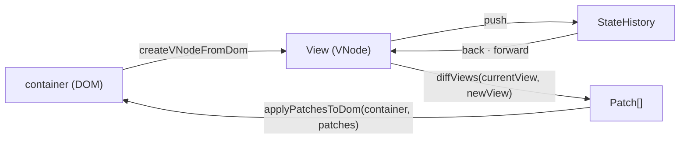
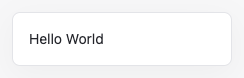

<!-- readme: archetype=team -->
# mini-react

Virtual DOM, Diff, Patch, Hooks를 바닐라 TypeScript로 직접 구현하면서 React가 이 기능들을 갖춘 이유를 이해하는 크래프톤 정글 팀 프로젝트입니다.

[](https://github.com/benjohnbill/mini-react/actions/workflows/ci.yml)

Status: active

## 실행

```bash
npm ci             # 도구 설치 (Node 버전: .nvmrc)
npm run dev        # 개발 서버에서 index.html 실행
npm run typecheck  # 타입 검사
npm run check      # 포맷, 린트, ADR이 인용한 테스트 ID 검사 (자동 수정: npm run format)
npm test           # 단위 테스트
npm run build      # 빌드
```

## Map (파일 지도)

```text
mini-react/
├── src/
│   ├── main.ts (entry)    페이지 시작 코드. index.html이 불러옴
│   ├── vnode.ts           VNode, DOM ↔ VNode 변환
│   ├── diff.ts            diffViews: 두 View → Patch 목록
│   ├── patch.ts           Patch 형식, applyPatchesToDom
│   ├── history.ts         StateHistory: 저장한 View 목록과 현재 위치
│   ├── function-component.ts  FunctionComponent, useState (Root Component를 감싸 mount와 update로 그림)
│   ├── test-pages/        검증 페이지와 데모 페이지 코드와 테스트
│   └── *.test.ts          테스트는 소스 옆에 둠
├── docs/adr/              되돌리기 어려운 결정과 이유. 폴더는 데이터가 지나가는 단계(docs/adr/README.md). 끝 두 줄의 ID = 지키는 테스트
├── docs/requirements/     LMS 문장마다 충족 판정과 근거 ADR (phase-1.md, phase-2.md)
├── scripts/
│   └── check-decision-links.mjs   ADR이 인용한 테스트 ID 확인. npm run check가 부름
├── .github/               PR 템플릿, CI(PR과 main push마다 검사)
├── GLOSSARY.md            코드와 문서의 이름
├── package.json           명령, 개발 도구. 런타임 의존성 없음. 설정은 tsconfig.json, biome.json, vitest.config.ts
└── AGENTS.md              에이전트 규칙. CLAUDE.md가 이 파일로 연결
```

## 다음에 읽을 것

- `CONVENTION.md`: 작업을 시작하기 전에 읽습니다.
- `AGENTS.md`: 에이전트에게 작업을 맡기기 전에 읽습니다.

Agents: if a path named here does not exist, report it to the owner.

## 동작 흐름



함수 이름은 `src/`의 export와 같습니다. `src/main.ts`가 검증 페이지와 데모 페이지를 시작합니다. 단계별 흐름은 `docs/adr/README.md`에 있습니다.

## Root Component를 쓸 때

Root Component 본문은 렌더링마다 처음부터 다시 실행됩니다. 그래서 아래 규칙을 지켜야 칸과 화면이 어긋나지 않습니다.

| 규칙 | 어기면 | 알려 주는 곳 |
| ---- | ------ | ------------ |
| Hook은 Root Component 본문 맨 위에서, 매번 같은 순서로 부릅니다 | 뒤쪽 Hook이 앞쪽 칸의 값을 받습니다 | Biome `useHookAtTopLevel` |
| 클릭 함수 안에서는 Hook을 부르지 않고, 렌더링 때 받은 값과 setter를 씁니다 | `Error` | 실행할 때, Biome |
| 렌더링 중에는 setter를 부르지 않습니다 | `Error` | 실행할 때 |
| 자식 Component는 `function create<이름>` 선언으로 쓰고, Hook을 쓰지 않습니다 | 자식을 빼면 뒤쪽 Hook의 칸이 밀립니다 | Biome (`function` 선언일 때), 리뷰 |
| Root Component는 PascalCase로 짓습니다 (예: `CounterRootComponent`) | Biome이 클릭 함수 안의 Hook을 놓칩니다 | 리뷰 |
| 본문에서 DOM을 직접 고치지 않습니다 | 다음 Patch가 그 변경을 몰라 화면이 View와 어긋납니다 | 리뷰 |

근거 ADR (`docs/adr/` 아래): `render/hook-cells-are-found-by-call-order`, `render/hook-outside-render-throws-error`, `setter/setter-during-render-throws-error`, `render/hook-rule-kept-by-convention`, `team/hook-position-checked-by-lint`, `instance/component-returns-view-and-function-component-draws`.

## 팀

| GitHub 계정   | 브랜치    |
| :------------ | :-------- |
| `benjohnbill` | `CJG`     |
| `oyatmin1031` | 직접 생성 |
| `DavinAn6`    | `Davin`   |

## 마일스톤 범위

마일스톤과 할 일은 팀 보드에 있습니다: https://github.com/users/benjohnbill/projects/7

## 규칙

브랜치, PR, 커밋, 병합 규칙과, ADR의 결정과 테스트를 잇는 규칙은 `CONVENTION.md`에 있습니다.

## 시작하기

```bash
git clone https://github.com/benjohnbill/mini-react.git
cd mini-react
git switch -c <이니셜>
git push -u origin <이니셜>
npm ci
npm test
```


## Getting Started

Node.js **26**이 필요합니다(`.nvmrc` 기준). 저장소를 내려받고 개발 서버를 실행하세요.

```bash
git clone https://github.com/benjohnbill/mini-react.git
cd mini-react
npm ci
npm run dev
```

### Hello World

Root Component는 화면을 설명하는 `VNode`를 돌려주는 함수입니다. 문자열도 VNode이므로 다음 코드만으로 첫 화면을 그릴 수 있습니다.

[docs/examples/hello-world/main.ts](docs/examples/hello-world/main.ts):

아래 상대 import 경로는 `docs/examples/hello-world/` 기준입니다.

```ts
import { FunctionComponent } from "../../../src/function-component";

const container = document.querySelector("#app");
if (container === null) {
  throw new Error("#app 요소가 필요합니다");
}

new FunctionComponent(() => "Hello World").mount(container);
```

HTML에는 화면을 그릴 요소와 TypeScript 파일을 불러오는 코드가 필요합니다. 위 코드는 이미 저장소에 있으므로 파일을 수정하지 않고 실행할 수 있습니다. 아래는 실행에 필요한 [index.html](docs/examples/hello-world/index.html)입니다.

```html
<!doctype html>
<html lang="ko">
  <head>
    <meta charset="UTF-8" />
    <meta name="viewport" content="width=device-width, initial-scale=1" />
    <title>Hello World | mini-react</title>
    <link rel="stylesheet" href="../examples.css" />
  </head>
  <body>
    <main>
      <div id="app"></div>
    </main>
    <script type="module" src="./main.ts"></script>
  </body>
</html>
```

개발 서버를 실행한 뒤 브라우저에서 `http://localhost:5173/docs/examples/hello-world/`를 여세요. 화면에 `Hello World`가 표시됩니다. 포트가 다르면 `5173`을 터미널에 표시된 포트로 바꾸세요.



### 더 많은 예제

[예제 모음](docs/examples/README.md)에서 mini-react의 주요 기능을 사용하는 더 많은 예제를 확인할 수 있습니다.
