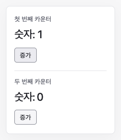

# 컴포넌트 조합

같은 Root Component로 독립적인 카운터 두 개를 만듭니다.

## 실행

저장소 루트에서 `npm ci`, `npm run dev`를 실행한 뒤 [예제 열기](http://localhost:5173/docs/examples/composition/)로 이동합니다. 포트가 다르면 터미널에 표시된 주소의 포트로 바꿉니다.

## 확인할 동작

첫 번째 증가를 눌러도 두 번째 카운터는 바뀌지 않습니다. `createCountLine({ count })`는 props를 받는 자식 Component이고 Hook은 Root Component에서만 호출합니다. 두 `FunctionComponent` 인스턴스가 각각 State를 보관합니다.

## 코드

- [main.ts](main.ts): 자식 Component, props, Root Instance 사용 코드
- [index.html](index.html): 실행용 HTML

[전체 예제](../README.md)
