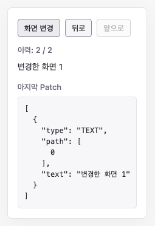

# 화면 변경과 되돌리기

화면 차이를 Patch로 반영하고 이력을 이동합니다.

## 실행

저장소 루트에서 `npm ci`, `npm run dev`를 실행한 뒤 [예제 열기](http://localhost:5173/docs/examples/history/)로 이동합니다. 포트가 다르면 터미널에 표시된 주소의 포트로 바꿉니다.

## 확인할 동작

화면 변경을 누르면 새 View를 반영하고 저장합니다. 뒤로·앞으로 버튼은 저장된 View를 불러 현재 View와 비교한 Patch를 반영합니다. 마지막 Patch 영역에서 실제 지시가 표시됩니다. 뒤로 간 뒤 화면 변경을 누르면 앞쪽 이력을 지웁니다. 이 예제는 Hook 대신 하위 API를 직접 사용합니다.

## 코드

- [main.ts](main.ts): createVNodeFromDom, diffViews, applyPatchesToDom, StateHistory 사용 코드
- [index.html](index.html): 실행용 HTML

[전체 예제](../README.md)
