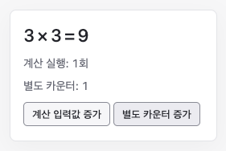

# 계산 결과 캐시

입력값의 제곱과 계산 실행 횟수를 표시합니다.

## 실행

저장소 루트에서 `npm ci`, `npm run dev`를 실행한 뒤 [예제 열기](http://localhost:5173/docs/examples/memo/)로 이동합니다. 포트가 다르면 터미널에 표시된 주소의 포트로 바꿉니다.

## 확인할 동작

처음에는 `3 × 3 = 9`, 계산 실행 1회입니다. 별도 카운터 증가를 눌러도 계산 실행은 1회입니다. 계산 입력값 증가를 누르면 `4 × 4 = 16`, 계산 실행 2회가 됩니다. 계산 횟수 변수는 동작 관찰용입니다. 제곱은 캐시 동작을 간단히 보여주기 위한 계산입니다.

## 코드

- [main.ts](main.ts): useMemo, deps 사용 코드
- [index.html](index.html): 실행용 HTML

[전체 예제](../README.md)
