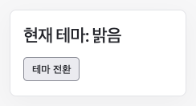

# 테마 전환

effect로 페이지의 배경을 바꿉니다.

## 실행

저장소 루트에서 `npm ci`, `npm run dev`를 실행한 뒤 [예제 열기](http://localhost:5173/docs/examples/theme/)로 이동합니다. 포트가 다르면 터미널에 표시된 주소의 포트로 바꿉니다.

## 확인할 동작

테마 전환을 누르면 setter인 `setIsDark`가 `isDark`를 바꾸고 렌더링을 시작합니다. `useEffect`의 deps인 `[isDark]`는 effect를 다시 실행할지 정합니다. 이 예제에서는 `isDark`가 바뀌었으므로 DOM 반영이 끝난 뒤 effect가 문서의 `colorScheme`을 바꿉니다. 공통 CSS가 `colorScheme`에 맞춰 배경·글자·버튼 색상을 적용합니다. 처음 화면을 그릴 때도 DOM 반영 후 effect를 실행합니다.

## 코드

- [main.ts](main.ts): useEffect, deps 사용 코드
- [index.html](index.html): 실행용 HTML

[전체 예제](../README.md)
