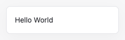
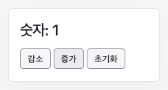
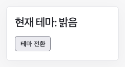
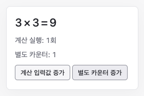
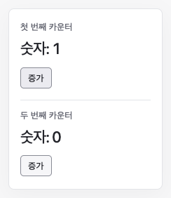
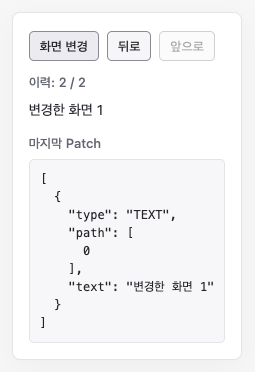

# Examples

이 예제들은 mini-react의 주요 기능을 사용하는 방법을 설명합니다. 각 이미지를 누르면 설명과 실행 코드로 이동합니다.

저장소 루트에서 Node.js 26으로 실행합니다.

```bash
npm ci
npm run dev
```

아래 실행 주소는 기본 포트 `5173` 기준입니다. 포트가 사용 중이면 터미널에 표시된 주소에 `/examples/<예제 이름>/`을 붙이세요.
개발 서버로 실행하는 예제이며, 기존 `npm run build`의 빌드 대상에는 포함되지 않습니다.

## Hook 사용 규칙

`useState`, `useEffect`, `useMemo`는 Root Component 본문의 최상위에서 렌더링마다 같은 순서로 호출하세요. 조건문·반복문·중첩 함수나 자식 Component 안에서 호출하지 마세요. mini-react는 호출 순서로 Hook의 칸을 찾습니다. 이 규칙은 코드가 모두 검사하지 않으므로 작성할 때 지켜야 합니다.

근거: [Hook 사용 범위](../docs/adr/render/hook-rule-kept-by-convention.md), [호출 순서와 Hook의 칸](../docs/adr/render/hook-cells-are-found-by-call-order.md).

## Hello World

[](hello-world/README.md)

문자열 하나를 화면에 표시합니다.

**사용 기능:** FunctionComponent, VNode

[설명](hello-world/README.md) · [TypeScript](hello-world/main.ts) · [HTML](hello-world/index.html) · [로컬 실행](http://localhost:5173/examples/hello-world/)

## 카운터

[](counter/README.md)

증가·감소·초기화 버튼으로 숫자를 바꿉니다.

**사용 기능:** useState, on, StateSetter

[설명](counter/README.md) · [TypeScript](counter/main.ts) · [HTML](counter/index.html) · [로컬 실행](http://localhost:5173/examples/counter/)

## 테마 전환

[](theme/README.md)

effect로 페이지의 배경을 바꿉니다.

**사용 기능:** useEffect, deps

[설명](theme/README.md) · [TypeScript](theme/main.ts) · [HTML](theme/index.html) · [로컬 실행](http://localhost:5173/examples/theme/)

## 계산 결과 캐시

[](memo/README.md)

입력값의 제곱과 계산 실행 횟수를 표시합니다.

**사용 기능:** useMemo, deps

[설명](memo/README.md) · [TypeScript](memo/main.ts) · [HTML](memo/index.html) · [로컬 실행](http://localhost:5173/examples/memo/)

## 컴포넌트 조합

[](composition/README.md)

같은 Root Component로 독립적인 카운터 두 개를 만듭니다.

**사용 기능:** 자식 Component, props, Root Instance

[설명](composition/README.md) · [TypeScript](composition/main.ts) · [HTML](composition/index.html) · [로컬 실행](http://localhost:5173/examples/composition/)

## 화면 변경과 되돌리기

[](history/README.md)

화면 차이를 Patch로 반영하고 이력을 이동합니다.

**사용 기능:** createVNodeFromDom, diffViews, applyPatchesToDom, StateHistory

[설명](history/README.md) · [TypeScript](history/main.ts) · [HTML](history/index.html) · [로컬 실행](http://localhost:5173/examples/history/)
