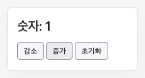

# 카운터

증가·감소·초기화 버튼으로 숫자를 바꿉니다.

## 실행

저장소 루트에서 `npm ci`, `npm run dev`를 실행한 뒤 [예제 열기](http://localhost:5173/examples/counter/)로 이동합니다. 포트가 다르면 터미널에 표시된 주소의 포트로 바꿉니다.

## 확인할 동작

증가를 두 번 누르면 2, 감소를 누르면 1, 초기화를 누르면 0이 됩니다. 증가·감소는 setter에 갱신 함수를 넘깁니다. `on`에 등록한 이름을 버튼의 `data-action`에 연결합니다.

## 코드

- [main.ts](main.ts): useState, on, StateSetter 사용 코드
- [index.html](index.html): 실행용 HTML

[전체 예제](../README.md)
