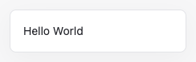

# Hello World

문자열 하나를 화면에 표시합니다.

## 실행

저장소 루트에서 `npm ci`, `npm run dev`를 실행한 뒤 [예제 열기](http://localhost:5173/examples/hello-world/)로 이동합니다. 포트가 다르면 터미널에 표시된 주소의 포트로 바꿉니다.

## 확인할 동작

페이지를 열면 `Hello World`가 표시됩니다. Root Component가 돌려준 문자열도 VNode입니다.

## 코드

- [main.ts](main.ts): FunctionComponent, VNode 사용 코드
- [index.html](index.html): 실행용 HTML

[전체 예제](../README.md)
