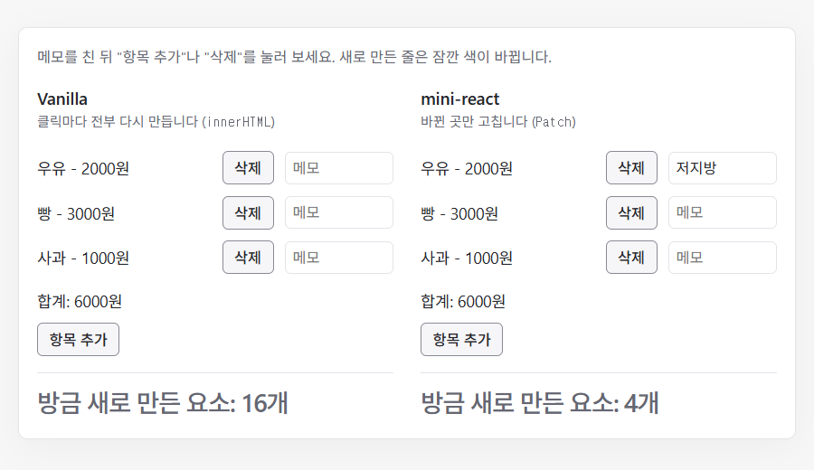

# 장보기 목록 (Vanilla와 비교)

같은 장보기 목록을 Vanilla 판과 mini-react 판으로 나란히 둡니다. Vanilla 판은 클릭마다 `innerHTML`로 전부 다시 만들고, mini-react 판은 바뀐 곳만 고칩니다.

## 실행

저장소 루트에서 `npm ci`, `npm run dev`를 실행한 뒤 [예제 열기](http://localhost:5173/examples/shopping-list/)로 이동합니다. 포트가 다르면 터미널에 표시된 주소의 포트로 바꿉니다.

## 확인할 동작

| 동작 | Vanilla | mini-react | 테스트 |
| ---- | ------- | ---------- | ------ |
| "항목 추가"를 누릅니다 | 요소 16개를 새로 만듭니다 (줄 셋과 합계와 버튼 전부) | 요소 4개를 새로 만듭니다 (새 줄 하나) | E7, E8 |
| 메모를 친 뒤 "항목 추가"를 누릅니다 | 입력란을 새로 만들어 친 메모가 사라집니다 | 같은 입력란이라 친 메모가 남습니다 | E7, E8 |
| "항목 추가"에 포커스를 두고 누릅니다 | 버튼을 새로 만들어 포커스를 잃습니다 | 같은 버튼이라 포커스가 남습니다 | E7, E8 |
| 첫 줄에 메모를 친 뒤 첫 항목을 "삭제"합니다 | 친 메모가 사라집니다 | 친 메모가 첫 줄에 남아 다음 항목 옆에 보입니다 | E9 |

마지막 줄은 mini-react의 한계입니다. `key`가 없어 같은 번호의 자식끼리 비교하므로([`diff-compares-same-index-children-first`](../../docs/adr/diff/diff-compares-same-index-children-first.md)), 입력란은 항목을 따라가지 않고 자리에 남습니다.

두 판 모두 메모를 State에 저장하지 않습니다. mini-react는 클릭 이벤트만 연결하기 때문입니다([`only-click-events-are-wired`](../../docs/adr/click/only-click-events-are-wired.md)).

판 아래의 "방금 새로 만든 요소"는 `MutationObserver`로 센 수입니다. 새로 만든 줄은 잠깐 색이 바뀝니다.

## 코드

- [main.ts](main.ts): mini-react 판. useState, on, 자식 Component 사용 코드
- [vanilla.ts](vanilla.ts): Vanilla 판. 클릭마다 `innerHTML`로 다시 만드는 코드
- [items.ts](items.ts): 두 판이 함께 쓰는 항목과 합계 계산
- [created-counter.ts](created-counter.ts): 클릭 뒤에 새로 들어온 요소를 세는 코드
- [index.html](index.html): 실행용 HTML

[전체 예제](../README.md)
